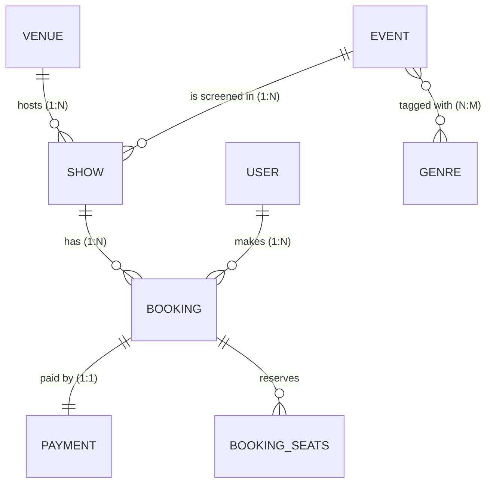

> **This fork** = [mysteriousmihir/BookMyHive](https://github.com/mysteriousmihir/BookMyHive) (all credit for the original app) **plus two new features** built as a .NET 10 sidecar: a PVR-style hero marquee and reviews/comments. Setup for the extras: [DOTNET-FEATURES.md](DOTNET-FEATURES.md).

# BookMyHive: Movie & Play Ticket Booking System

A BookMyShow-style ticket booking app with a honey-and-hive theme (amber, caramel and dark brown, with hexagonal seats).

| Layer | Technology |
|---|---|
| Frontend | React 18 + Vite + React Router |
| Backend (core) | Spring Boot 3.3 (Java 17), Spring Data JPA, Spring Security (JWT), Bean Validation |
| Backend (extras, new) | ASP.NET Core on .NET 10 Web API (minimal APIs), EF Core 10, JWT bearer auth shared with the Java backend |
| Database | MySQL 8 for the Java backend. The .NET service uses SQLite by default or MySQL via config |
| API testing | Postman collection (51 requests with assertions) + JUnit/Mockito (Java), xunit integration tests (.NET) |

---

## 1. Project concept & requirements

**Objective.** Let people discover movies and live plays, pick exact seats on a seat map and book tickets online, while giving theatre staff an admin console to manage the catalogue.

**Problem statement.** Buying cinema or theatre tickets at the counter is slow, and seat availability is unclear. Double bookings happen when several people buy at once. Venues need one place to manage titles, showtimes and prices.

**Roles**

| Role | Can do |
|---|---|
| Guest | Browse and search events, view showtimes and the live seat map, register, log in |
| USER | Everything a guest can, plus book seats, view *My bookings*, cancel their own upcoming bookings |
| ADMIN | Everything a user can, plus full CRUD on events, shows, venues, genres; view stats and all bookings; cancel any upcoming booking |

**Functional requirements**

1. Register and log in (JWT); role-based access (USER / ADMIN).
2. Browse movies and plays; filter by type, genre, language; search by title.
3. Event page with showtimes grouped by date and venue, filtered by the chosen city.
4. Interactive seat map (hexagon seats) showing taken, free and selected seats; up to 10 seats per booking.
5. Booking with a simulated payment (UPI / Card / Net banking) and a booking reference.
6. Cancel a booking before the show starts; seats are released and the payment is marked REFUNDED.
7. Admin console: CRUD for Events, Shows, Venues, Genres; list of all bookings; dashboard totals.
8. Data integrity: no double booking, referential checks before deletes, validation everywhere.

---

## 2. Architecture (Spring Boot, layered)

```
backend/src/main/java/com/bookmyhive
├── BookMyHiveApplication.java
├── config/        SecurityConfig (filter chain, CORS, BCrypt), DataSeeder (demo data)
├── security/      JwtService, JwtAuthFilter, CustomUserDetailsService
├── controller/    REST endpoints only: HTTP in/out, @Valid, status codes
├── service/       Business rules + @Transactional (booking, seat checks, conflicts)
├── repository/    Spring Data JPA interfaces + JPQL queries
├── entity/        JPA entities and enums (the database model)
├── dto/           Request/response records (entities are never exposed)
├── mapper/        Entity → DTO conversion
└── exception/     Custom exceptions + GlobalExceptionHandler (@RestControllerAdvice)
```

Request flow: `Controller → Service → Repository → MySQL`, with DTOs crossing the controller boundary and entities staying inside the service/repository layers.

```
frontend/src
├── api.js, context.jsx, utils.js      fetch wrapper (adds JWT), auth + city state, helpers
├── components/                        Navbar, EventCard, Poster, ResourceManager (generic CRUD UI) ...
└── pages/                             Home, EventDetail, SeatSelection, MyBookings, AuthPage, Admin
```

---

## 2a. .NET 10 extras service (hero marquee + reviews/comments)

This fork adds a second backend, a small ASP.NET Core (.NET 10) Web API in `dotnet-backend/BookMyHive.Api`. The Java backend is unchanged except for configurable seed passwords. The React frontend talks to both APIs. Full details: [DOTNET-FEATURES.md](DOTNET-FEATURES.md). Deployment notes: [DEPLOYMENT.md](DEPLOYMENT.md).

```
browser (React) --/api/*-------------------> Spring Boot (Java 17)   :8080  -> MySQL (bookmyhive)
        |                                      issues the JWT
        '--VITE_EXTRAS_API_URL (/api/*) ---> ASP.NET Core (.NET 10)  :5080  -> SQLite file, or MySQL (separate database)
                                               validates the SAME JWT
```

**What the .NET service provides**

| Feature | Endpoints | Who can call |
|---|---|---|
| Hero banners (PVR-style auto-sliding carousel on Home) | `GET /api/hero-banners`; `POST`, `DELETE /api/hero-banners/{id}` | GET public, write ADMIN |
| Reviews (1-5 stars, one per user per event, plus summary) | `GET /api/events/{id}/reviews`, `GET .../reviews/summary`, `POST .../reviews`, `DELETE /api/reviews/{id}` | GET public, POST signed-in, DELETE ADMIN |
| Comments (discussion thread per event) | `GET`/`POST /api/events/{id}/comments`, `DELETE /api/comments/{id}` | GET public, POST signed-in, DELETE ADMIN |
| Health | `GET /api/health` | public |

**Shared login.** The user logs in once through the Java API (`POST /api/auth/login`). The .NET service validates the same HS256 token (subject = email, `role` claim = USER or ADMIN), so no second login. Both services need the same secret, at least 32 bytes, and neither ships a default:

```bash
export JWT_SECRET="<your strong secret>"     # Java backend
export Jwt__Secret="<same value>"            # .NET service
export TMDB_API_KEY="<your own TMDB key>"    # Java backend (catalogue sync)
```

**Run it (after the Java backend is up)**

```bash
cd dotnet-backend/BookMyHive.Api
dotnet run --urls http://localhost:5080      # needs the .NET 10 SDK
```

**Database.** Default is SQLite (`bookmyhive-extras.db`). To use MySQL set `Database__Provider=MySql` and `ConnectionStrings__Extras`, and give it its own database, separate from the Java one, because the schema is created by EF Core `EnsureCreated`, which skips a database that already has tables. The MySQL path (Oracle `MySql.EntityFrameworkCore` 10.0.12) was run locally against MySQL 9.7.4: tables created, data survived a restart, and a token from the Java login was accepted. It has not been run against MySQL 8.x or a hosted MySQL.

**CORS.** Allowed origins come from `Cors__Origins__0`, `Cors__Origins__1`, and so on. The default is the Vite dev server (`http://localhost:5173`).

**Frontend wiring.** `VITE_EXTRAS_API_URL` sets the .NET API base URL (default `http://localhost:5080/api`). `VITE_API_URL` sets the Java API base URL (default `/api`).

**Tests.** `cd dotnet-backend/BookMyHive.Api.Tests && dotnet test` runs 8 xunit integration tests.

---

## 3. Entities & relationships



| Relationship | Type | Implementation |
|---|---|---|
| User → Bookings | One-to-Many | `@OneToMany(mappedBy="user")` / `@ManyToOne` |
| Event → Shows, Venue → Shows, Show → Bookings | One-to-Many / Many-to-One | `@ManyToOne(fetch = LAZY)` on `Show` and `Booking` |
| Booking ↔ Payment | **One-to-One** | `Payment.booking` (owner, unique FK), `Booking.payment` (`mappedBy`, cascade ALL) |
| Event ↔ Genre | **Many-to-Many** | `@ManyToMany` + join table `event_genres` |
| Booking → seats | Element collection | table `booking_seats` (`A1`, `A2`, …) |

Tables are created automatically (`spring.jpa.hibernate.ddl-auto=update`).

---

## 4. REST API

Base URL: `http://localhost:8080/api`. Protected endpoints need `Authorization: Bearer <token>`.

| Method | Endpoint | Access | Success | Error codes |
|---|---|---|---|---|
| POST | `/auth/register` | Public | 201 | 400 validation, 409 email exists |
| POST | `/auth/login` | Public | 200 | 400, 401 bad credentials |
| GET | `/events?type=&q=&genre=&language=` | Public | 200 | n/a |
| GET | `/events/{id}` | Public | 200 | 404 |
| GET | `/events/{id}/shows?city=` | Public | 200 | 404 |
| POST | `/events` | ADMIN | 201 (+`Location`) | 400, 401, 403, 404 genre |
| PUT | `/events/{id}` | ADMIN | 200 | 400, 401, 403, 404 |
| DELETE | `/events/{id}` | ADMIN | 204 | 401, 403, 404, 409 has bookings |
| GET | `/shows/{id}` (seat map + `bookedSeats`) | Public | 200 | 404 |
| POST / PUT / DELETE | `/shows`, `/shows/{id}` | ADMIN | 201 / 200 / 204 | 400, 403, 404, 409 has bookings |
| GET | `/venues`, `/venues/{id}`, `/genres` | Public | 200 | 404 |
| POST / PUT / DELETE | `/venues…`, `/genres…` | ADMIN | 201 / 200 / 204 | 400, 403, 404, 409 in use |
| POST | `/bookings` | USER, ADMIN | 201 | 400 invalid seat or show started, 401, 404, 409 seat taken |
| GET | `/bookings/my` | USER, ADMIN | 200 | 401 |
| PATCH | `/bookings/{id}/cancel` | Owner or ADMIN | 200 | 400 show started, 403, 404, 409 already cancelled |
| GET | `/admin/stats`, `/admin/events`, `/admin/shows`, `/admin/bookings` | ADMIN | 200 | 401, 403 |

### Validation & error responses

Bean Validation annotations (`@NotBlank`, `@Email`, `@Size`, `@Min/@Max`, `@Future`, `@DecimalMin`, `@NotEmpty` …) live on the request DTOs. Every failure goes through `GlobalExceptionHandler` and returns the same JSON shape:

```json
{
  "timestamp": "2026-10-25T14:03:11.402",
  "status": 400,
  "error": "Bad Request",
  "message": "Validation failed",
  "path": "/api/auth/register",
  "fieldErrors": { "email": "Enter a valid email address", "password": "Password must be 6-60 characters" }
}
```

| Exception | HTTP |
|---|---|
| `MethodArgumentNotValidException`, `BadRequestException`, malformed JSON | 400 |
| `AuthenticationException` / missing or invalid token | 401 |
| `AccessDeniedException` (wrong role or not the owner) | 403 |
| `ResourceNotFoundException` | 404 |
| `ConflictException`, `DataIntegrityViolationException` | 409 |
| anything unexpected (logged server-side, no stack trace leaked) | 500 |

### Authentication & authorization

* Passwords are hashed with BCrypt; login returns a signed JWT (HS256, 24 h) containing the email and role.
* `JwtAuthFilter` validates the token on each request; the app is fully stateless.
* Public: auth routes and `GET` on events/shows/venues/genres. Everything else needs a token.
* ADMIN-only routes use `@PreAuthorize("hasRole('ADMIN')")` (enabled by `@EnableMethodSecurity`).
* Public sign-up always creates a `USER`. Admins are seeded (or changed directly in the DB).

### Preventing double booking

`BookingService.create` runs in one transaction and loads the show with a **pessimistic write lock** (`SELECT … FOR UPDATE`). Concurrent requests for the same show are serialized, so the seat check and the insert cannot interleave. Seat labels are also validated against the show's row/column layout.

---

## 5. Run it

**Prerequisites:** Java 17+, Maven 3.9+, Node 18+, MySQL 8 running locally, and the .NET 10 SDK for the extras service.

### Database & backend

```bash
cd backend
# Default credentials are root/root on localhost:3306. Override if needed:
#   export DB_USERNAME=root DB_PASSWORD=yourpassword
mvn spring-boot:run
```

The database `bookmyhive` is created automatically (`createDatabaseIfNotExist=true`). On the first start `DataSeeder` inserts demo data:

| Account | Email | Password |
|---|---|---|
| Admin | `admin@bookmyhive.com` | `Admin@123` |
| User | `user@bookmyhive.com` | `User@123` |

It also inserts 9 events (6 movies, 3 plays), 6 venues in 4 cities, genres, and about 6 days of upcoming shows. Set `app.seed.enabled=false` to turn this off.

### .NET extras service

See section 2a. Set the same `JWT_SECRET` / `Jwt__Secret` on both services, then `dotnet run --urls http://localhost:5080` in `dotnet-backend/BookMyHive.Api`. The .NET 10 SDK is required for this step.

### Frontend

```bash
cd frontend
npm install
npm run dev        # http://localhost:5173  (proxies /api to localhost:8080)
```

---

## 6. Testing

**Postman.** Import `postman/BookMyHive.postman_collection.json`, then run the collection (Runner, top to bottom). It contains 51 requests in 6 folders (auth, public catalogue, admin CRUD, authorization checks, bookings, cleanup). Each request has a test script that asserts the status code and key fields, and tokens and IDs are passed between requests through collection variables. The run covers the happy paths and the error cases 400, 401, 403, 404 and 409.

**.NET tests.** `cd dotnet-backend/BookMyHive.Api.Tests && dotnet test` runs 8 xunit integration tests covering health, hero banners (admin-only management), reviews (token required, duplicate = 409, rating range), comments, and rejection of a forged token.

**Unit tests (Java).** `cd backend && mvn test` runs `BookingServiceTest` (Mockito): total price calculation, seat conflict detection, out-of-layout seats, started shows, cancel by owner, cancel by another user (denied) and by admin (allowed).

---

## 7. Requirement checklist

| # | Requirement | Where |
|---|---|---|
| 1 | Concept & requirements | Section 1 |
| 2 | Spring Boot structure | Section 2, `backend/` |
| 3 | CRUD | Events, Shows, Venues, Genres (full CRUD); Bookings (create, read, cancel); Users (create, read) |
| 4 | MySQL + Spring Data JPA | `application.properties`, `repository/` |
| 5 | Entities & relationships | Section 3, `entity/` (1:1, 1:N, N:1, N:M) |
| 6 | REST APIs | Section 4, `controller/` |
| 7 | Layered architecture | controller / service / repository / entity / dto / mapper |
| 8 | Validation & exceptions | DTO annotations, `exception/GlobalExceptionHandler` |
| 9 | Auth & authorization | `security/`, `config/SecurityConfig`, `@PreAuthorize` |
| 10 | Testing | `postman/`, `src/test`, `dotnet-backend/BookMyHive.Api.Tests` |
| 11 | Code quality | Records for DTOs, constructor injection, small single-purpose classes, Javadoc on non-obvious rules |
| 12 | .NET extras (new) | Section 2a, `dotnet-backend/` |

## 8. Ideas for future work

Real payment gateway, seat-hold timers, e-mail tickets with QR codes, poster uploads, pagination on lists, refresh tokens, Testcontainers integration tests.
